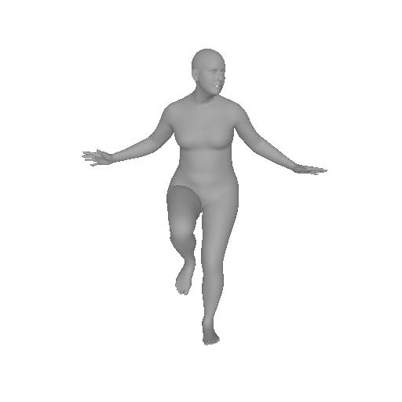
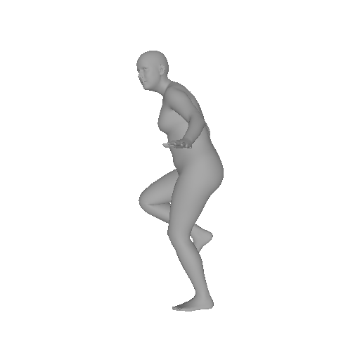
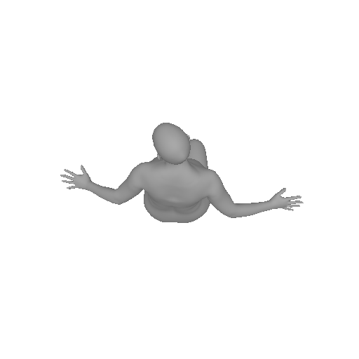

# PoseEmbroider-Lite

**把 [PoseEmbroider](https://github.com/naver/poseembroider)（ECCV 2024）做成 ~300 MB 的免 PyTorch 部署版：输入一张图片，输出 SMPL-X 人体网格。**

纯 CPU 运行，单张约 **0.2 秒**，不需要安装 PyTorch / CUDA。输出的 `OBJ` 可以直接拖进 Blender 查看。

> [English](README.md) | **简体中文**

<p align="center">
  
  
  
  
</p>
<p align="center"><i>输入 → 预测网格的正视 / 侧视 / 顶视图</i></p>

## 亮点

| | 原版 PoseEmbroider | **本项目** |
|---|---|---|
| 运行时 | PyTorch + CUDA（约 5–7 GB） | **NumPy + ONNX Runtime（约 90 MB）** |
| 权重 | 约 1.2 GB 的 `.pth` | **179 MB fp16 ONNX + 28 MB SMPL-X** |
| 总占用 | 约 8.5 GB | **约 300 MB** |
| 速度（CPU，单张） | — | **约 170–340 ms** |
| 精度（对比原版管线） | — | **关节旋转误差 0.12°** |

- **两刀瘦身**
  1. 图像推理用不到的 text/pose 编码器（posetext 313MB + distilbert 268MB）直接跳过 —— 输出逐位一致；
  2. 整条 图像→SMPL-X 参数 链路导出为 ONNX，fp16 量化，SMPL-X 蒙皮用 NumPy 重写 —— 彻底摆脱 PyTorch。
- **自带 Web UI**：拖图即测，显示三视图渲染（没装渲染库时直接给 OBJ）。
- **数值可验证**：与原版 torch 管线对齐到 3e-7（见[精度](#精度)）。

## 快速开始

### 1. 安装依赖

```bash
pip install -r requirements.txt
```
已在 Python 3.8–3.12 上测试。注意：Python 3.8 最高只能装 `onnxruntime 1.19`，请使用 **fp32** 模型（原因见下）。

### 2. 下载模型

模型托管在 Hugging Face：**[foxdream/poseembroider-lite](https://huggingface.co/foxdream/poseembroider-lite/tree/main)**

```bash
# 推荐：fp16（179 MB）
huggingface-cli download foxdream/poseembroider-lite image_to_params_fp16.onnx --local-dir models

# 或者：fp32（357 MB，Python 3.8 / onnxruntime < 1.31 时使用）
huggingface-cli download foxdream/poseembroider-lite image_to_params.onnx --local-dir models

# SMPL-X 精简体模型（28 MB）
huggingface-cli download foxdream/poseembroider-lite smplx_neutral_lite_f32.npz --local-dir models
```

> **注意**：**fp16** 模型要求 `onnxruntime >= 1.31`。旧版本（例如 Python 3.8 只能装到 1.19）加载后会静默输出 `NaN`，此时请改用 **fp32** 模型。

### 3. 运行

```bash
# 命令行：图片 -> 网格 + 参数
python runtime/infer.py --image photo.jpg --out_dir out

# Web UI（http://127.0.0.1:6007）
python webui.py
```

`runtime/infer.py` 会输出：
- `out/smplx_mesh.obj` —— SMPL-X 网格（10475 顶点），Blender 导入时 **Up Axis 选 Y**
- `out/smplx_params.npz` —— `rotvec`（22×3）、`betas`（10）、`verts`（10475×3）

可选三视角渲染（`--render`）需要额外安装 `pyrender trimesh PyOpenGL`。

## 精度

与原始 PoseEmbroider torch 管线在同一张图上的对比：

| 组件 | 关节旋转误差 | betas 误差 | 顶点误差 |
|---|---|---|---|
| fp32 ONNX | **0.000°**（逐位一致） | 0.0000 | 0 mm |
| fp16 ONNX | 0.122°（最大 0.60°） | 0.0030 | — |
| NumPy 版 SMPL-X LBS | — | — | **3e-7**（float32 精度极限） |
| int8 动态量化 | 19.3° ✗ | 0.71 ✗ | 不可用 |
| int8 静态量化（QDQ） | 40.1° ✗ | 1.41 ✗ | 不可用 |

本模型**对 int8 量化过于敏感**（ViT + 对比学习表征），fp16 是最优折中。数据可用 `validate/compare_final.py` 复现。

## 速度

（RTX 2080 Ti 服务器，纯 CPU onnxruntime，单张图片）

| 版本 | ONNX | NumPy LBS | 端到端 |
|---|---|---|---|
| fp32 | 211 ms | 30 ms | ~241 ms |
| fp16 | 311 ms | 30 ms | ~341 ms |

普通桌面 CPU 实测：约 157 ms（fp32）+ 5 ms LBS。**部署 Web UI 时请设置 `OMP_NUM_THREADS=4`** —— 不限制 BLAS 线程数时，Flask 内的 LBS 会慢 60 倍（5 ms → 300 ms）。

## 目录结构

```
.
├── runtime/
│   ├── infer.py            # 推理入口（ONNX + NumPy LBS + 导出 OBJ）
│   └── numpy_lbs_fast.py   # NumPy 版 SMPL-X 线性混合蒙皮
├── webui.py                # Flask 网页：上传 -> 网格 / 三视图
├── models/                 # 模型文件（需从 HF 下载，已被 .gitignore 排除）
├── export/                 # 生成 ONNX 模型的一次性脚本
│   ├── lite_encoders.py        # 第一刀：跳过未使用的 text/pose 编码器
│   ├── export_params_onnx.py   # 第二刀：torch -> ONNX 导出
│   ├── export_fp16.py          # fp16 转换
│   ├── quantize_static_qdq.py  # int8 实验（精度不达标，仅存档）
│   ├── pack_smplx.py           # SMPL-X npz 瘦身：104 MB -> 28 MB
│   └── dump_features.py        # 导出 torch 基准输出用于对齐
├── validate/               # 数值对齐与性能基准
│   ├── compare_final.py        # lite vs 原版 torch
│   ├── validate_lbs.py         # NumPy LBS vs smplx(torch)
│   ├── final_bench.py          # 延迟基准
│   └── test_orient.py          # 全局朝向约定验证
└── docs/images/            # README 配图
```

## 工作原理

```
图片 (192x256, /255)
  -> ONNX: SMPLer-X ViT-B -> 图像投影(768->512) -> L2 归一化
           -> + 模态编码 -> intermodality token
           -> embroider  transformer 核心
           -> 姿势头(22x3x3 旋转矩阵) + 体型头(10 个 betas)
  -> 旋转矩阵转旋转向量（NumPy）   [全局朝向修正：Rx(-90°)，见下]
  -> NumPy SMPL-X LBS（55 关节，平手均值姿态） -> 10475 个顶点
```

### 踩过的坑（都值得知道）

1. **ONNX 导出撞上 Transformer 融合算子** —— PyTorch 会把 `TransformerEncoderLayer` 融合成 `aten::_transformer_encoder_layer_fwd`，ONNX 无法导出。导出前必须调用 `torch.backends.mha.set_fastpath_enabled(False)`。
2. **int8 量化不可行** —— 动态 int8 在随机噪声输入上误差只有 0.8°，看起来很美；换成真实图片立刻恶化到 19–40°。**量化一定要用真实数据验证**。
3. **全局朝向约定** —— 模型输出的 `global_orient` 位于 BEDLAM 的相机坐标系（Y 轴向下）。需对根关节左乘 `Rx(-90°)` 转到标准 Y-up / 面向 +Z 坐标系；否则人体网格会"躺平"（俯视图反而像正视图）。
4. **SMPL-X LBS 的两个细节**（`numpy_lbs_fast.py`）
   - `flat_hand_mean=True` 时姿态均值**全为零**（不是 `hands_mean`）；
   - `smplx.lbs.batch_rigid_transform` 的齐次坐标用 `F.pad` 默认补 **0**（不是 1），所以刚体变换修正是 `t - R·J`，而不是 `t - (R·J + t)`。
5. **`item['poses']` 必须存在** —— `HPSEstimator.forward` 即使只做图像推理也会读取它（仅用于获取 device），塞个占位张量即可。

## 重新导出 ONNX 模型

只有想从原始 checkpoint 重建 `image_to_params*.onnx` 时才需要。需要完整的原版 PoseEmbroider 环境（PyTorch、4 个检查点、SMPL-X、SMPLer-X backbone，见上游仓库），然后按顺序：

```bash
python export/export_params_onnx.py   # torch -> fp32 ONNX（需要原版检查点）
python export/export_fp16.py          # fp32 -> fp16
python export/pack_smplx.py           # 精简 SMPL-X npz
```

## 局限性

这是一个**语义姿态表征**模型被复用做网格恢复，并非专门的 HMR 网络。以下场景会明显弱于专用方法：

- **精细的腿部/胯部姿态**（例如交叉腿、精细的腰椎弯曲）；
- 罕见姿势（训练数据是 5 万个最远点采样的 BEDLAM 姿势）；
- 严重自遮挡。

原因（见原论文 limitations）：图像特征被**平均池化成单个 512 维 token**、只用**排序（对比）目标**训练（没有重建损失）、回归头训练时**表征是冻结的**。如果需要精确的全身捕捉，请选用 SMPLer-X / HMR2.0 / OSX / Multi-HMR 等专用模型。

## 致谢与许可

- 原方法与模型权重：[PoseEmbroider](https://github.com/naver/poseembroider)（Delmas 等，ECCV 2024），[arXiv:2409.06535](https://arxiv.org/abs/2409.06535)
- 图像编码器：[SMPLer-X](https://github.com/caizhongang/SMPLer-X)（ViT-B）
- 人体模型：[SMPL-X](https://smpl-x.is.tue.mpg.de/)

本项目是 PoseEmbroider 的**衍生作品**，沿用相同的 **[CC BY-NC-SA 4.0](https://creativecommons.org/licenses/by-nc-sa/4.0/)** 许可 —— **仅限非商业用途**。SMPL-X 体模型受马克斯·普朗克研究所的独立许可约束，需自行申请获取。

## 引用

```bibtex
@inproceedings{delmas2024poseembroider,
  title={PoseEmbroider: Towards a 3D, Visual, Semantic-aware Human Pose Representation},
  author={Delmas, Ginger and Weinzaepfel, Philippe and Moreno-Noguer, Francesc and Rogez, Gr{\'e}gory},
  booktitle={ECCV},
  year={2024}
}
```
